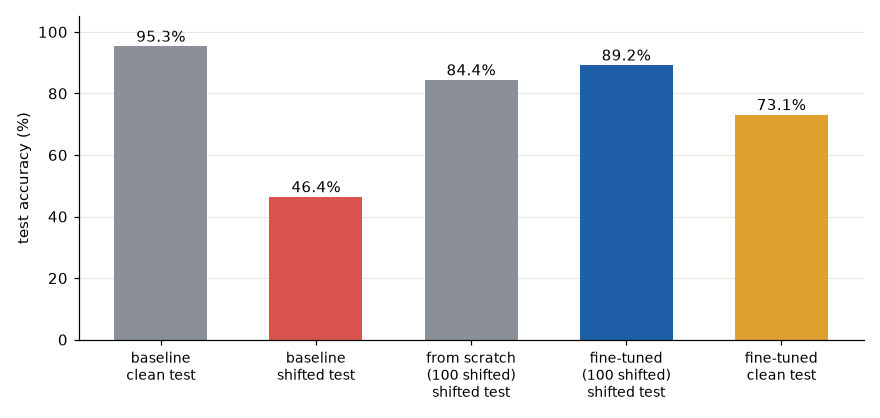

# Digit Domain Shift

Testing how badly a simple digit classifier breaks when the images shift a little, and how much new data it takes to fix it. Inspired by coursework using this data.

The model is a small MLP (64 -> 64 -> 10, about 4.8k parameters) trained on the 8x8 handwritten digits dataset from scikit-learn. On the normal test set it gets 95% accuracy. For the "shifted" version of the data, every image gets moved one pixel to the right and has Gaussian noise added (std 0.15). The digits still look basically the same to a person, but the model drops to 46%.



To fix it I fine-tuned the clean model on only 100 shifted images, which got it back up to 89%. To check if starting from the pretrained model actually helped, I also trained the same model from scratch on those same 100 images, and it only got to 84%. So the pretrained weights were worth about 5 points.

The problem is the last bar. After fine-tuning, the model drops from 95% to 73% on the original clean images, IE it forgot a good chunk of what it learned the first time (catastrophic forgetting). With only 100 examples, 40 epochs, and the same learning rate as the original training, it's pretty much overfitting to the new data. If I come back to this I'd try a lower learning rate, fewer epochs, or mixing some clean images into the fine-tuning set.

A one pixel shift hurting this much also makes sense for an MLP, since every pixel position is its own input and the model has no idea a shifted 3 is still a 3. A CNN would probably handle the shift a lot better.

## Setup

The data is split 60/20/20 into train/val/test, stratified by digit, with a fixed seed so every run gets the same split. Pixel values get scaled from 0-16 down to 0-1. Training is plain SGD with cross-entropy loss, learning rate 0.1, 40 epochs, and batch size 32 (16 for the 100 image runs). All the numbers above come from running the commands below as is.

## Running it

```bash
pip install -r requirements.txt

python train.py                    # baseline on clean data -> baseline_model.pt
python train.py --mode finetune    # fine-tune the baseline on 100 shifted images -> finetune_model.pt
python train.py --mode scratch     # new model on the same 100 images -> scratch_model.pt

python evaluate.py baseline_model.pt
python evaluate.py baseline_model.pt --shifted
python evaluate.py finetune_model.pt --shifted
python evaluate.py scratch_model.pt --shifted
python evaluate.py finetune_model.pt
```

`evaluate.py` prints the accuracy, sklearn's classification report, and a confusion matrix. Everything runs on CPU in a few seconds.
